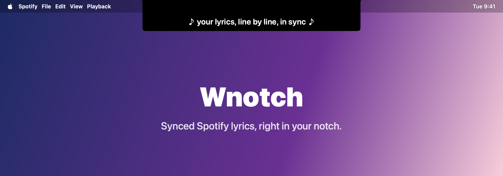
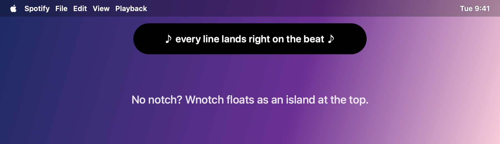
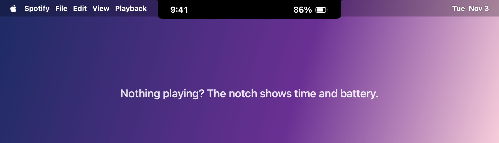

<p align="center">
  
</p>

<h1 align="center">Wnotch</h1>

<p align="center">
  <b>Lirik Spotify yang tersinkron, langsung di notch kamu.</b><br/>
  Aplikasi macOS native yang mengubah notch menjadi tampilan hidup untuk lirik, musik, dan aktivitas sistem.
</p>

<p align="center">
  <a href="README.md">English</a> · <b>Bahasa Indonesia</b>
</p>

<p align="center">
  <a href="https://github.com/bagusmibr/Wnotch/releases/latest"></a>
  
  
  <a href="LICENSE"></a>
</p>

<p align="center">
  
</p>

## Fitur

| | |
|---|---|
| 🎤 **Lirik Spotify** | Saat Spotify diputar, notch hanya menampilkan baris lirik yang sedang dinyanyikan, tetap pas walau lagu dimajukan atau dimundurkan. |
| ⏯️ **Kontrol di atas lirik** | Tombol sebelumnya, putar/jeda, dan berikutnya langsung di atas lirik, tanpa perlu membuka Spotify. |
| 🕘 **Tidak pernah kosong** | Tidak ada lagu? Notch menampilkan jam dan sisa baterai. |
| 🏝️ **Bisa tanpa notch** | Di Mac tanpa notch dan monitor eksternal, Wnotch tampil sebagai kapsul mengambang di atas layar. |
| 🎵 **Now Playing** | Kontrol musik, gambar album, dan progres lagu untuk Spotify, Apple Music, dan lainnya. |
| ⚡ **Aktivitas langsung** | Unduhan, AirDrop, timer, rekam layar, Focus, Personal Hotspot. |
| 🔋 **Notifikasi** | Mengisi daya, baterai lemah/penuh, Bluetooth, Wi-Fi, VPN, serta HUD volume dan kecerahan. |
| 🌍 **39 bahasa** | Termasuk Bahasa Indonesia dan Inggris. |

<p align="center">
  
  
</p>

<sub>Gambar merupakan ilustrasi tampilan aplikasi.</sub>

## Unduh

| Platform | Status |
|---|---|
| macOS 14 Sonoma atau lebih baru | ✅ [Unduh rilis terbaru](https://github.com/bagusmibr/Wnotch/releases/latest) |
| Windows | 🚧 Segera hadir |

## Cara pasang (macOS)

1. Unduh `Wnotch.dmg` dari halaman [Releases](https://github.com/bagusmibr/Wnotch/releases/latest).
2. Buka file tersebut, lalu seret **Wnotch** ke folder **Applications**.
3. Wnotch belum dinotarisasi Apple, jadi hapus tanda karantina sekali saja lewat Terminal:
   ```bash
   xattr -dr com.apple.quarantine /Applications/Wnotch.app
   ```
4. Buka Wnotch dan izinkan akses yang diminta:
   - **Automation → Spotify** untuk membaca posisi lagu agar lirik tersinkron
   - **Accessibility** untuk HUD volume/kecerahan

Lirik bisa dinyalakan atau dimatikan di **Settings → Now Playing → Lirik Spotify di notch**, dan jam saat idle di **Settings → Notch → Display**.

## Tanya jawab

**Kenapa beberapa lagu hanya menampilkan judul?**
Lirik diambil dari database gratis [LRCLIB](https://lrclib.net). Jika lagu belum tersedia di sana, Wnotch menampilkan judul lagunya.

**Apakah Wnotch mengumpulkan data?**
Tidak. Tidak ada akun, analitik, atau pelacakan. Wnotch hanya menghubungi:
- [LRCLIB](https://lrclib.net) / [Lyrics.ovh](https://lyrics.ovh) untuk mencari lirik lagu yang sedang diputar
- `api.country.is` (cadangan `ipapi.co`, `ipwho.is`) untuk menampilkan negara VPN, hanya saat VPN tersambung

## Build dari source

Setiap push ke `main` otomatis membuat DMG lewat GitHub Actions dan menjalankan unit test.

Dengan Xcode:

```bash
git clone https://github.com/bagusmibr/Wnotch.git
cd Wnotch
./build_dmg.sh
```

## Terima kasih

- [LRCLIB](https://lrclib.net) dan [Lyrics.ovh](https://lyrics.ovh) untuk data lirik
- [mediaremote-adapter](https://github.com/ungive/mediaremote-adapter) (BSD-3-Clause) untuk akses Now Playing
- [Lottie](https://github.com/airbnb/lottie-ios) dan [Sparkle](https://sparkle-project.org)

## Pengembang

Dibuat oleh **M** · [Website](https://portobagusmibr.vercel.app/) · [Instagram @bagusmibr](https://instagram.com/bagusmibr)

## Lisensi

[GPL-3.0](LICENSE)
